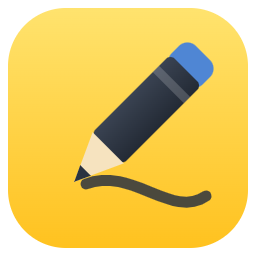
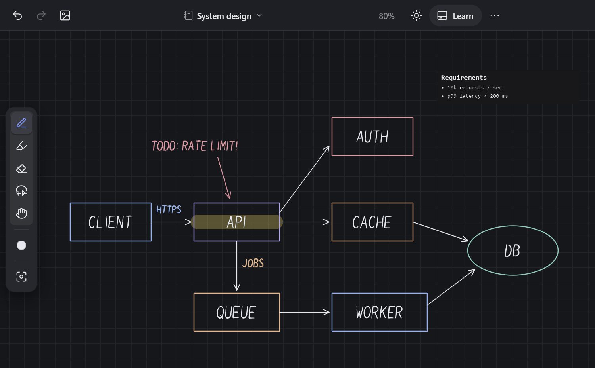

<p align="center"></p>

<h1 align="center">FunDraw</h1>

<p align="center">Version 1.0.0</p>

A fast, simple notebook for sketching ideas by hand with a pen tablet.
FunDraw has an infinite canvas, supports pen pressure, and lets you paste images from anywhere.



## Features

- **Pen with pressure.** Works with drawing tablets such as the XP-Pen Deco Fun. Turn on **Windows Ink** in the tablet driver to get pressure.
- **Tools.** Pen, highlighter, eraser and lasso, with six soft colors and three sizes.
- **Clean lines and shapes.** Hold the pen still at the end of a stroke to turn it into a straight line, circle, triangle or rectangle.
- **Pasted images.** Paste screenshots or images with **Ctrl+V**, then move, resize, crop or fade them.
- **Infinite canvas.** Pinch to zoom and scroll with two fingers. Press **Home** to bring your drawings back into view.
- **Learn mode.** Shrinks the window into a narrow strip that stays on top of other windows, so you can follow a lesson and write at the same time.
- **Boards.** Keep a separate board for each topic. Boards save automatically.
- **Display options.** Dark mode, grid or ruled lines, and export to PNG.

## Install

Run `FunDraw 1.0.0.msi` from the `dist` folder.

## Develop

```bash
npm install
npm start      # run the app
npm run icon   # rebuild the icons from assets/icon.svg
npm run dist   # build the MSI installer into dist/
```

## Releases

Every push to `master` runs GitHub Actions. The workflow builds the MSI, tags the commit and publishes a GitHub release with the installer attached.
Each release is versioned automatically: it takes the newest `v*` tag and adds 1 to the last number (1.0.0, 1.0.1, 1.0.2, …).
To start a new minor or major version, tag a commit yourself, for example `git tag v1.1.0`, and push the tag.

## Shortcuts

| Key | Action |
| --- | --- |
| P / I / E / V / H | Pen, highlighter, eraser, lasso, pan |
| 1–6 | Colors |
| [ ] | Pen size |
| Ctrl+Z / Ctrl+Y | Undo / redo |
| Ctrl+V | Paste an image |
| Ctrl+C / Ctrl+D | Copy as an image / duplicate |
| Home | Center your drawings |
| G / Shift+G | Grid / ruled lines |
| D | Dark mode |
| L | Learn mode |
| Ctrl+N | New board |
